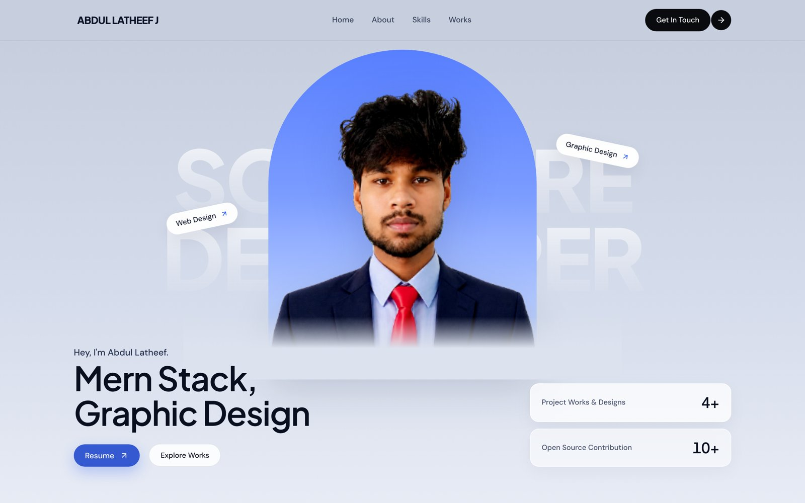
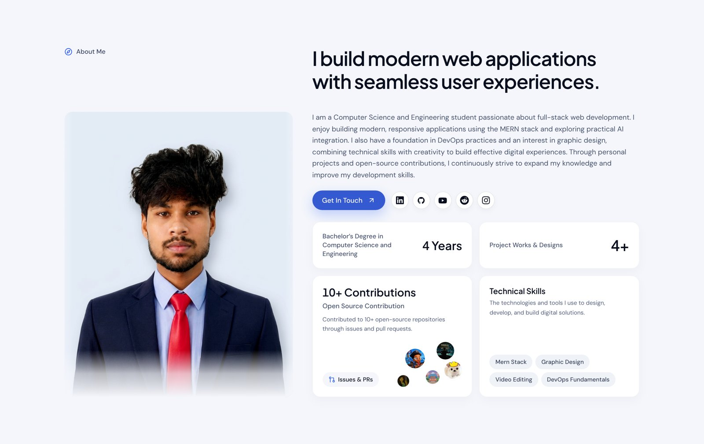
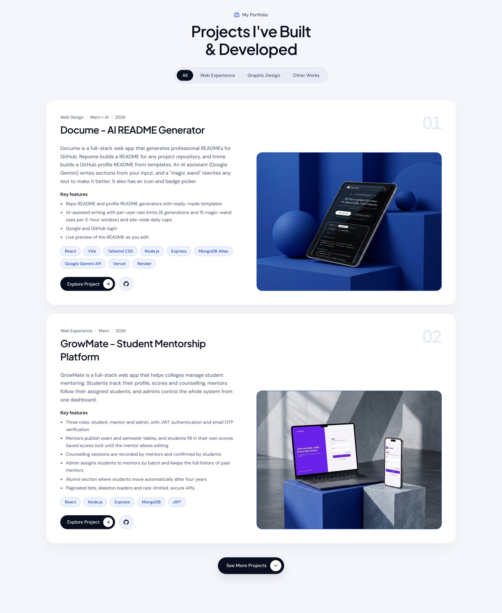
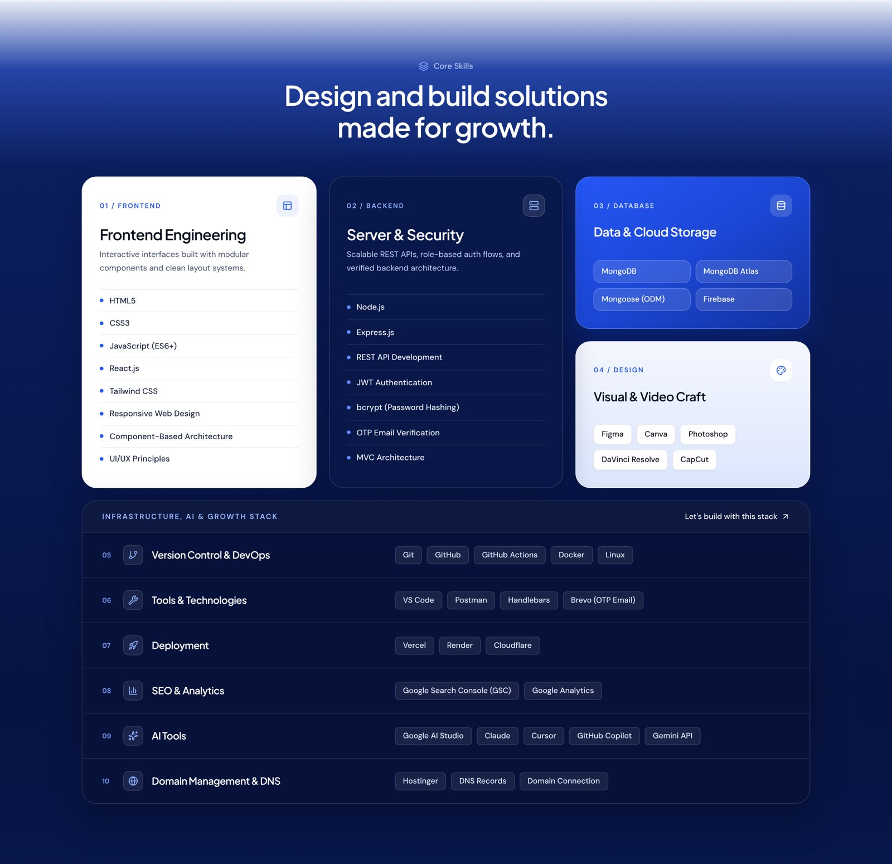
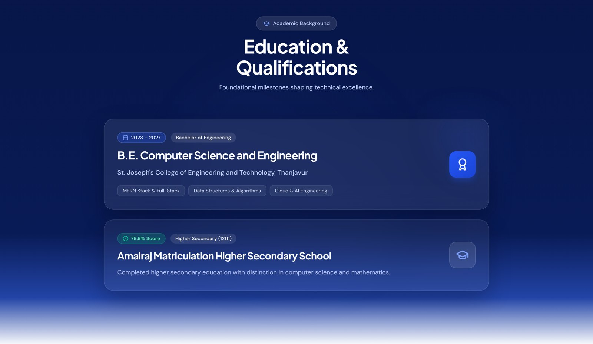
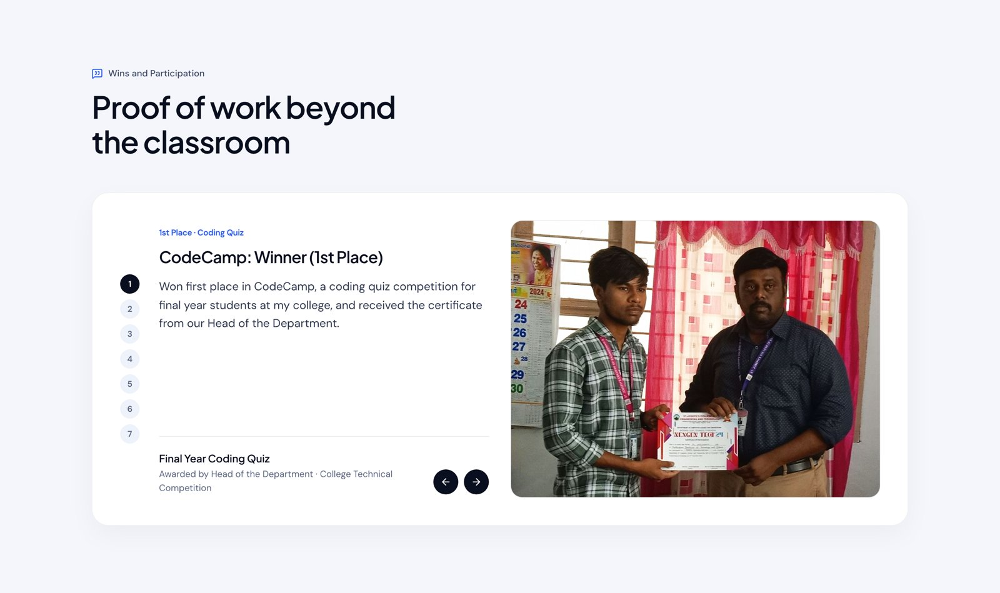
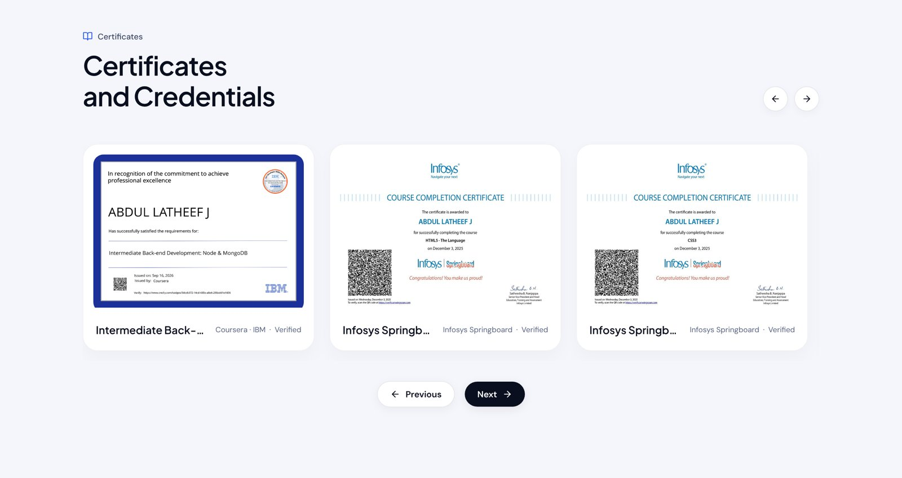

<div align="center">

# Abdul Latheef J — Portfolio

A personal portfolio website presenting my projects, technical skills, education, achievements and certifications.

**[Live Demo](https://abdullatheef.vercel.app/)** · [GitHub](https://github.com/Abdullatheef01) · [LinkedIn](https://www.linkedin.com/in/abdul-latheef-j-5576752b9/) · [YouTube](https://www.youtube.com/@CodewithAbdulofficial)




</div>

## Features

- **Resume viewer:** read the resume in a popup or download the PDF
- **Project showcase:** filter by Web Experience, Graphic Design or Other Works, and open project details
- **Skills overview:** frontend, backend, database, design, DevOps, deployment and AI tools
- **Education, achievements and certificates:** each certificate opens in a detail view
- **Contact form:** input validation, with messages sent through [Formspree](https://formspree.io/)
- **FAQ section**
- **Responsive layout** built with Tailwind CSS

## Screenshots

### About


### Projects


### Skills


### Education


### Achievements


### Certificates


## Tech Stack

| Category | Technology |
| --- | --- |
| Library | React 19 |
| Language | TypeScript |
| Build tool | Vite 8 |
| Styling | Tailwind CSS 4 |
| Icons | Lucide React |
| Fonts | Plus Jakarta Sans, DM Sans |
| Forms | Formspree |
| Hosting | Vercel |

## Getting Started

### Prerequisites

- [Node.js](https://nodejs.org/) 20.19+ or 22.12+
- npm

### Installation

```bash
git clone https://github.com/Abdullatheef01/Abdullatheef.git
cd Abdullatheef
npm install
cp .env.example .env
npm run dev
```

Open [http://localhost:3000](http://localhost:3000) in your browser.

### Environment Variables

| Variable | Description |
| --- | --- |
| `VITE_FORMSPREE_ENDPOINT` | Formspree form URL that receives contact form messages |

> **Note:** If you fork this project, replace the value with your own Formspree endpoint. When deploying, add this variable in your hosting settings.

### Scripts

| Command | Description |
| --- | --- |
| `npm run dev` | Start the development server on port 3000 |
| `npm run build` | Create a production build in `dist/` |
| `npm run preview` | Preview the production build |
| `npm run lint` | Run the TypeScript type check |
| `npm run clean` | Remove the build output |

## Project Structure

```text
├── public/
│   ├── assets/portfolio-media/   # Resume PDF and media files
│   ├── favicon.png
│   └── og-img.png                # Social share image
├── screenshots/                  # README images
├── src/
│   ├── assets/                   # Profile, project and certificate images
│   ├── components/               # Page sections and modals
│   ├── data/portfolioData.ts     # Projects, achievements, FAQs, certificates
│   ├── App.tsx
│   ├── index.css
│   └── main.tsx
├── index.html
├── vite.config.ts
└── package.json
```

## Customization

- Most content is in `src/data/portfolioData.ts`.
- Text for the About, Skills, Education and Footer sections is inside the matching files in `src/components/` (Skills is `ServicesSection.tsx`, Education is `PricingSection.tsx`).
- To update the resume, add the new PDF to `public/assets/portfolio-media/` and change `resumePdf` in `portfolioData.ts`.

## Contact

**Abdul Latheef J**

- **Email:** [abdullatheefsjcetcse@gmail.com](mailto:abdullatheefsjcetcse@gmail.com)
- **LinkedIn:** [abdul-latheef-j](https://www.linkedin.com/in/abdul-latheef-j-5576752b9/)
- **GitHub:** [Abdullatheef01](https://github.com/Abdullatheef01)
- **YouTube:** [@CodewithAbdulofficial](https://www.youtube.com/@CodewithAbdulofficial)
